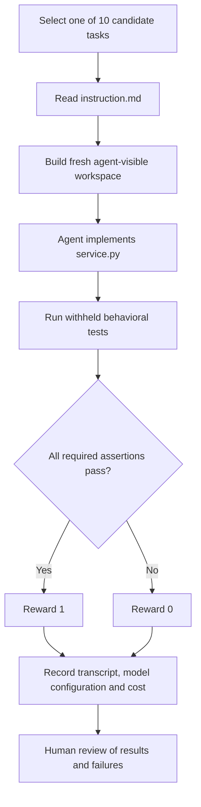
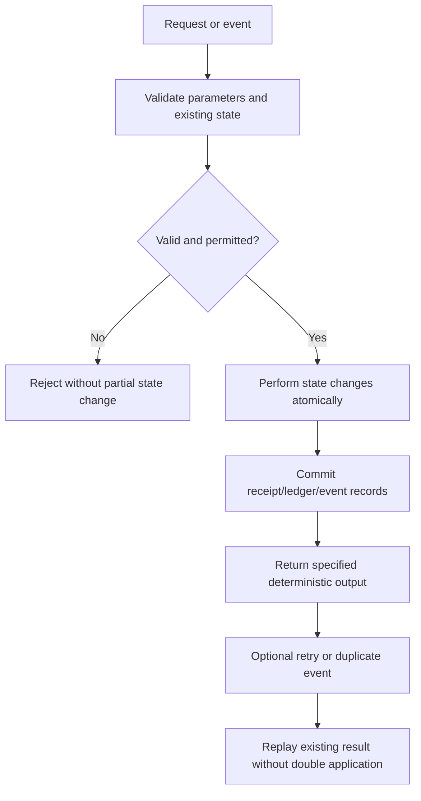

# Transaction Integrity Eval — Application and Evaluation Flow

## 1. Candidate task flow



## 2. Local developer checks

```bash
python scripts/preflight.py
python run_eval.py validate
```

The validator checks each candidate against its reference solution, its unsolved starter code, and a deliberately incorrect mutant. These checks are preliminary; they do not replace the fuller grader audit.

## 3. Formal Harbor run (intended)

```bash
harbor run -p tasks/T02_refund-ceiling -a oracle
harbor run -p tasks/T02_refund-ceiling -a nop
harbor run -p tasks/T02_refund-ceiling -a mini-swe-agent -m '<provider/exact-model-id>'
```

The precise agent/model combination and installed Harbor CLI must be verified locally. The first two commands confirm that a solution can pass and that an unsolved workspace does not. Formal model trials must preserve the same frozen task and grader across compared models.

## 4. Lifecycle of a transaction-focused task



This is a conceptual pattern across the benchmark, **not** a claim that all ten tasks implement identical service functions or a single shared application database.

## 5. Results and research flow
Run pilot tasks T01, T02 and T04 first. Treat pilot scores as diagnostic until specifications and graders are frozen. For formal trials, record exact model and agent versions, settings, clean-run isolation, complete transcripts, grader outputs, dates, cost, and runtime. Analyze success as well as failure. A candidate should only be called difficult for frontier models after genuine repeatable evidence establishes that claim.
