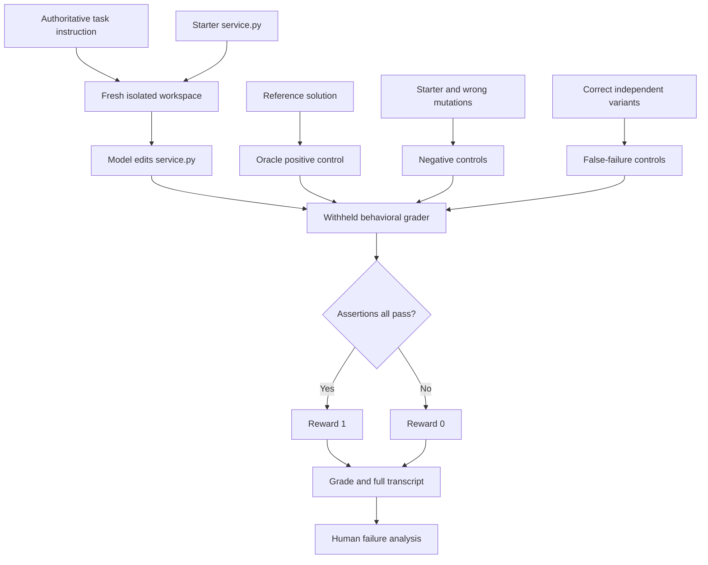

# Transaction Integrity Eval — Architecture

## Purpose
A small, offline-first **agentic benchmark** for transaction-processing software. Ten Python coding tasks cover idempotency, refunds, journals, webhook ordering, reconciliation, currency conversion, proration, payout allocation, disputes and inbox/outbox atomicity. This is a prototype research instrument, **not** a measured claim about model limitations.

## Evaluation pipeline

## Source layout and trust boundaries

| Component | Role | Visible to evaluated agent? |
|---|---|---|
| `tasks/*/instruction.md` | Complete behavioral specification | Yes, task only |
| `tasks/*/environment/service.py` | Deliberately flawed starter | Yes, task only |
| `tasks/*/environment/Dockerfile` | Creates task environment (only starter copied) | Built into agent container |
| `tasks/*/solution/` | Known-correct Oracle implementation | No; Oracle phase only |
| `tasks/*/tests/` | Pytest grader and reward writer | No; verifier phase only |
| `tasks/*/mutants/` | Intentionally incorrect code | No |
| `audit_variants/` | Alternative correct implementation | No |
| `run_eval.py` | Local diagnostic harness, workspace staging, grading, evidence recording | Never mount repository root into agent container |
| `results/`, `transcripts/` | Genuine trial evidence, generated after testing | No |

The *local* Python runner is a developer diagnostic, **not** a sandbox for untrusted agent-generated code. Use Harbor + Docker (or an equivalently isolated system) for formal trials. The public repository includes answers; only a **verified network restriction** can prevent a model from retrieving a publicly accessible solution. The default task runtime policy is `no-network`, but hosted agents often need provider-specific outbound API connectivity. This must be tested, not assumed.

## Local and Harbor grading

1. `scripts/preflight.py` checks task structure, runner scripts and network defaults.
2. `run_eval.py validate` runs one reference, one unfinished starter and one wrong mutant per task. A failed test assertion is a valid negative control; collection errors and timeouts are infrastructure failures.
3. `scripts/audit_variants.py` accepts other correct approaches and rejects additional realistic financial bugs.
4. `scripts/repeatability.py` runs repeated controls to probe local flakiness.
5. In Harbor the Oracle agent copies `solution/service.py` to `/app/service.py`; the NOP leaves the starter unchanged. Then `tests/test.sh` runs withheld pytest and writes `1` or `0` to `/logs/verifier/reward.txt`.
6. Only genuine, model-generated attempts count as trial evidence. Preserve transcript, task/grade hashes, exact model ID, agent setup, and runtime/cost.

## Transaction-specific behavior

T01, T02, T03 and T10 use durable SQLite transactions. T01/T02/T10 include bounded multi-connection probes for competing requests, and error injection tests cover rollback. Remaining tasks implement deterministic pure-Python logic. No single database schema or application server is shared across all tasks.

## Unverified external dependencies

The code can be locally checked without cloud credentials. A working Harbor CLI and Docker environment, provider credentials, network-isolation proof, external model trials, an accessible video link and expert transcript analysis cannot be proven simply by shipping this package.
