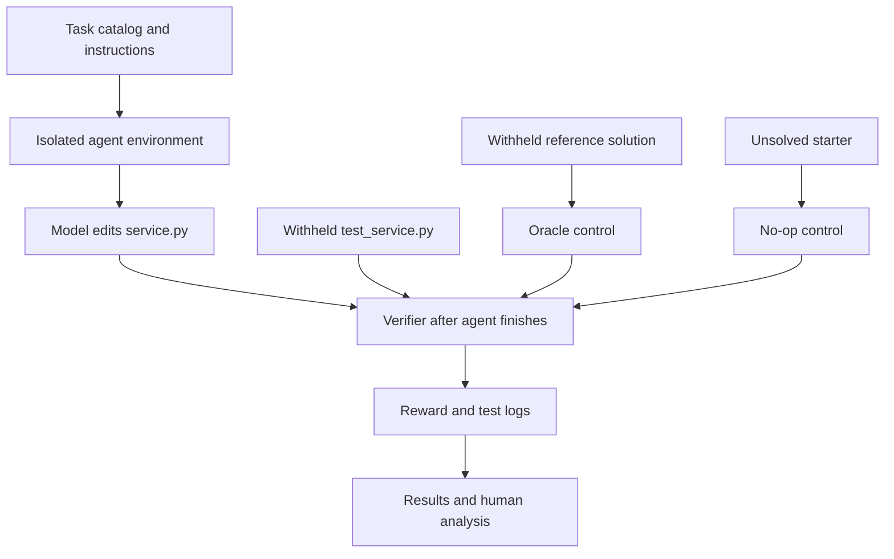

# Transaction Integrity Eval — Architecture

## Purpose and scope
Transaction Integrity Eval is an offline-first, original coding-agent benchmark designed to investigate whether models preserve financial invariants under retries, concurrent operations, reordering, and partial failures. The repository currently contains **ten candidate tasks**, not validated evidence of a frontier-model limitation.

## Main components

- `tasks/T01_...` through `tasks/T10_...`: independent Python/SQLite coding challenges; each defines its own behavior contract.
- `instruction.md`: the problem and visible expectations given to the evaluated agent.
- `environment/service.py`: the deliberately incomplete or flawed code the agent modifies.
- `environment/Dockerfile`: agent runtime image, copying the starter code only.
- `solution/service.py` and `solution/solve.sh`: known-correct candidate and Oracle application script; withheld during model attempts.
- `tests/test_service.py` and `tests/test.sh`: behavioral grader; `test.sh` writes `/logs/verifier/reward.txt` in Harbor.
- `mutants/service.py`: intentionally incorrect implementation for testing whether the grader catches specific defects.
- `run_eval.py`: local validation, workspace preparation, offline grading, recording, and summaries. It is **not** a sandbox for untrusted model code.
- `scripts/preflight.py`: structural checks for task manifests, file availability, isolation declarations, and executable scripts.
- `results/` and `transcripts/`: local validation records and eventual genuine model-trial evidence. No frontier-model results are established by the starter package.

## Isolation and trust boundaries
The agent should receive only the task instruction and starter environment, never the grader, mutant, reference solution, or other tasks. Harbor/Docker is the intended formal task runner; the custom local runner supports diagnostics and is not a security boundary. Because the repository is public, independently enforce network and repository-access restrictions for formal trials so an agent cannot fetch exposed reference answers.

## Storage and execution model
Most tasks use pure Python or SQLite and the standard library. T01, T02, T03 and T10 exercise persistent SQLite state. Other tasks operate on in-memory values with explicit, deterministic rules. Each trial must begin from a fresh environment. For database tasks, new database state must be constructed for each test.

## Validation layers
1. **Structural preflight:** files, executable scripts, task TOML, expected verifier output path.
2. **Reference/no-op/mutant control:** reference passes; incomplete and known-wrong implementations fail.
3. **Grader reliability audit:** deliberately wrong variants are rejected and *alternative valid implementations* are accepted.
4. **Harbor acceptance:** run Oracle and NOP in actual Docker/Harbor environments; this step still requires machine-side verification.
5. **Model trials:** collect raw trajectories, exact model IDs/settings, time/cost, pass rates, and a manually reviewed failure analysis.

## Known gaps
Deterministic multi-connection concurrency grading for T01, T02 and T10 is not yet fully validated. A passing local smoke test does not prove comprehensive grader reliability. The benchmark must not claim demonstrated frontier-model failures before trials have occurred.
