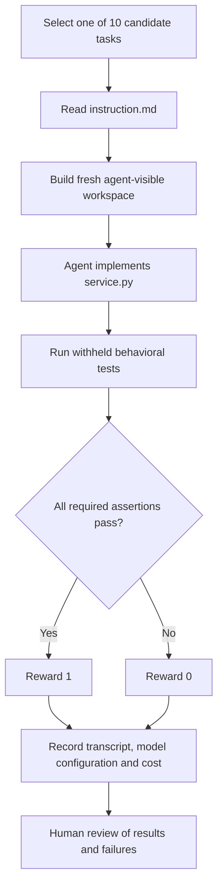
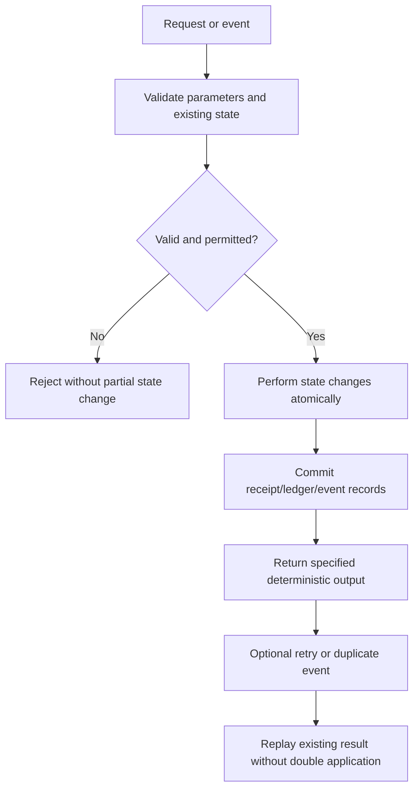

# Transaction Integrity Eval — Technical Documentation

This is an original, offline-first Python/SQLite **coding-agent evaluation**, not a production payment service. Each task is independent: the agent receives its `instruction.md` and a deliberately flawed `environment/service.py`, implements a fix, and has its final code graded by tests it could not read during the attempt. A correct reference and wrong alternatives are used to calibrate the grader. The evaluation asks whether coding agents preserve financial invariants under retries, concurrency, reordering and failed database writes.

## Problems and invariants


Can coding agents preserve financial transaction invariants not only in the happy path, but also under concurrent requests, repeated operations, reordered messages, interrupted writes, and recovery?

**Status:** These ten problems are original evaluation candidates, not confirmed model failure cases. The full authoritative contract for each lives in `tasks/<task>/instruction.md`.

| ID | Problem | Required invariant | Why it can be challenging |
|---|---|---|---|
| T01 | Idempotent payment capture | Same key and payload never debit twice; conflicting key reuse does not change funds | Debit and receipt must commit together during retries and contention |
| T02 | Partial refund ceiling | Cumulative committed refunds never exceed capture; duplicate requests do not double-credit | Competing individually valid refunds and errors between credit and receipt |
| T03 | Double-entry transfer | Exact minor units and balanced debit/credit entries; atomic writes | Partial postings and conflicting replay requests |
| T04 | Out-of-order webhooks | Only valid transitions consume sequence and event identity; terminal states stay terminal | Early future events may need to be retried after a missing predecessor |
| T05 | Settlement reconciliation | Correct duplicate, missing, unexpected, mismatch, and total accounting | A set-based reconciliation can lose authoritative duplicate-row details |
| T06 | Currency conversion | Exact decimal arithmetic with defined source and target scales; half-even final rounding | Precision boundaries and different currency minor units |
| T07 | Subscription proration | Compute once from actual elapsed UTC seconds with half-even final rounding | Timezone offsets, half-open intervals, and separately rounded portions |
| T08 | Marketplace payout allocation | Conserve every cent and resolve equal remainders deterministically | Tie-breaking, order independence, and fee/net separation |
| T09 | Dispute deadline lifecycle | Honor inclusive UTC evidence deadlines; forbid invalid terminal transitions | Equivalent timestamps with different offsets and duplicate event IDs |
| T10 | Transactional inbox/outbox | Balance, inbox and outbox changes commit atomically; duplicates are idempotent | Failures between writes and competing redeliveries |

## Candidate prioritization

**First pilot:** T01, T02, T04.  
**Second wave:** T03, T05, T10.  
**Reserve:** T06, T07, T08, T09.

Do not exclude successful trials or select tasks solely for low observed scores. Record why a task was retained or excluded based on professional relevance, task clarity, grader reliability, and reproducible model behavior.

## Specific correctness conventions
- T01 and T02 permit safe handling of real SQLite lock contention as defined in their instructions; the grader must not require a particular SQL locking statement.
- T03 represents money in exact minor units, with decimal-string inputs and matching-currency accounts.
- T04 ignores out-of-order *invalid transitions* without consuming their sequence or event ID.
- T05 treats the first duplicate in each input source as authoritative, as the task contract specifies.
- T06 uses `Decimal` and `ROUND_HALF_EVEN`; USD/EUR=2 decimals, JPY=0, KWD=3.
- T07 uses timezone-aware UTC instants, half-open periods, whole seconds, and one final half-even rounding step.
- T08 applies integer largest-remainder allocation with seller-ID lexical tie-breaking.
- T09 compares aware timestamps as UTC instants and uses an inclusive evidence deadline.
- T10 includes the durable outgoing event in the same transaction as the deduplicated balance adjustment.

## Grader reliability and documented limitations
All required behaviors must follow the visible task instructions. Known-correct *alternative* implementations should pass; wrong fixes should fail. Bounded multi-connection tests for T01, T02 and T10 are included, but broader concurrency coverage and independent audit remain necessary. The official micro1 submission must report only genuine, recorded frontier-model trials and observed outcomes.


## Application and evaluation flow




## 2. Local developer checks

```bash
python scripts/preflight.py
python run_eval.py validate
```

The validator checks each candidate against its reference solution, its unsolved starter code, and a deliberately incorrect mutant. These checks are preliminary; they do not replace the fuller grader audit.

## 3. Formal Harbor run (intended)

```bash
harbor run -p tasks/T02_refund-ceiling -a oracle
harbor run -p tasks/T02_refund-ceiling -a nop
harbor run -p tasks/T02_refund-ceiling -a mini-swe-agent -m '<provider/exact-model-id>'
```

The precise agent/model combination and installed Harbor CLI must be verified locally. The first two commands confirm that a solution can pass and that an unsolved workspace does not. Formal model trials must preserve the same frozen task and grader across compared models.

## 4. Lifecycle of a transaction-focused task



This is a conceptual pattern across the benchmark, **not** a claim that all ten tasks implement identical service functions or a single shared application database.

## 5. Results and research flow
Run pilot tasks T01, T02 and T04 first. Treat pilot scores as diagnostic until specifications and graders are frozen. For formal trials, record exact model and agent versions, settings, clean-run isolation, complete transcripts, grader outputs, dates, cost, and runtime. Analyze success as well as failure. A candidate should only be called difficult for frontier models after genuine repeatable evidence establishes that claim.


## Score interpretation

A task yields **reward 1** when the final implementation passes every required behavior test, and **reward 0** otherwise. Source-level paths, specific lock statements or one preferred algorithm are not a scoring dimension. Always review rejected solutions for a grader false-failure. This benchmark scores the code's end state, not an agent's claims.

## Operational references

- `README.md` — complete clean setup, research objective, results placeholders and submission checklist
- `evaluation/REPRODUCIBILITY.md` — Harbor/Docker commands and network-access controls
- `evaluation/CALIBRATION_RUNBOOK.md` — exact validation and live-trial steps
- `evaluation/GRADER_VALIDATION.md` — reference, negative-mutant and alternative-positive control methodology
- `evaluation/RESULTS_REPORT_TEMPLATE.md` — real-run result and failure analysis format
- `scripts/package_submission.py` — produce a final evidence-including ZIP only after tests

The most authoritative contract for each individual problem is its own `tasks/Txx_.../instruction.md`.
